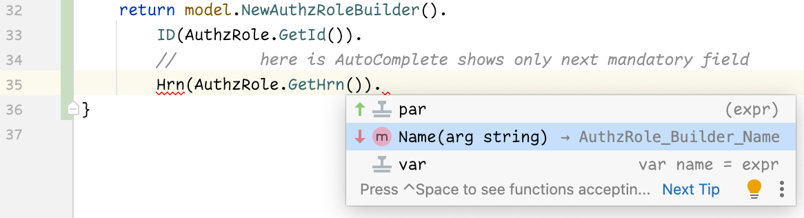
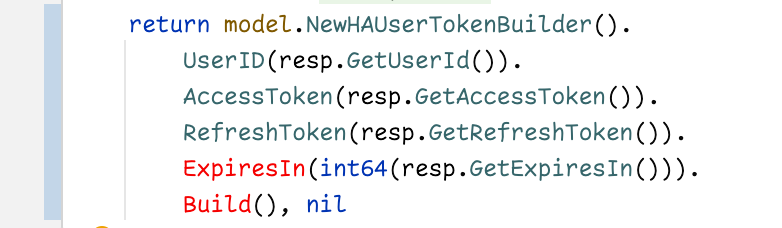

# gobetter

> [!WARNING]
> **v0.20.0 is incompatible with v0.18 annotations and CLI commands.** Before upgrading,
> migrate `+gob:...` annotations to `//gobetter:...` and update your
> generation commands. This README uses v0.20.0 syntax; see the
> [migration guide](#migrating-from-older-versions) for the required changes.

gobetter generates Go builders that make required fields part of the compiler's checks.
You fill in each field by name, and your IDE shows the next required setter.

Add `//gobetter:struct builder` above a struct:

```go
package models

//gobetter:struct builder
type Person struct {
    Name  string
    Email string
    //gobetter:field optional
    Comment string
}
```

After generation, use its builder:

```go
person := NewPersonBuilder().
    Name("Ada").
    Email("ada@example.com").
    Comment("First programmer"). // Optional; you can go straight to Build().
    Build()
```

Skip a required field, and the chain won't compile:

```go
NewPersonBuilder().Name("Ada").Build() // Build is unavailable until you set Email.
```

Add a required field to the struct and regenerate. The compiler points out the builder calls
that need updating.

**Your IDE guides the next step, without a plugin:**



**An incomplete chain produces a compiler error:**



*These screenshots show an earlier API. The code on this page uses v0.20.0.*

## Contents

- [Install and generate](#install-and-generate)
- [Using builders](#using-builders)
- [Getters, String, and Equal](#getters-string-and-equal)
- [Generics, embedded fields, and nested structs](#generics-embedded-fields-and-nested-structs)
- [Code from other generators](#code-from-other-generators)
- [Optional configuration](#optional-configuration)
- [Annotation reference](#annotation-reference)
- [Command reference](#command-reference)
- [Generated files](#generated-files)
- [Migrating from older versions](#migrating-from-older-versions)

## Install and generate

Use **Go 1.26 or newer** for gobetter and the projects that use its generated code.

### Register the tool

Track gobetter in your project's `go.mod` so developers and CI use the version your project
selects. This README describes the unreleased v0.20.0; the following installation commands
will work after publication. To try the checkout now, use the local build instructions below.

```sh
go get -tool github.com/mobiletoly/gobetter/cmd/gobetter@v0.20.0
```

The command records the module version and adds this tool entry:

```go
tool (
    github.com/mobiletoly/gobetter/cmd/gobetter
)
```

Commit `go.mod` and `go.sum`. Run the registered tool with `go tool gobetter`.

<details>
<summary>Standalone installation and local builds</summary>

After publication, you can install a standalone binary:

```sh
go install github.com/mobiletoly/gobetter/cmd/gobetter@v0.20.0
```

Use `gobetter` instead of `go tool gobetter` in the commands and directives below.

To use an unpublished checkout, build from this repository:

```sh
go build -o ./bin/gobetter ./cmd/gobetter
```

Run the binary by its absolute path from your consumer package, passing `generate .`.
For repeat generation, use that path in your `go:generate` directive too.

</details>

### Generate your builder

Save the `Person` declaration above as `person.go` in your `models` package.

**For the entire package**, add a handwritten `generate.go` in the same directory:

```go
package models

//go:generate go tool gobetter generate .
```

This generates builders for annotated structs across the package, including new source files
you add later.

**For a single file**, put this directive in `person.go` instead:

```go
//go:generate go tool gobetter generate -file=$GOFILE
```

`go generate` expands `$GOFILE` to the name of the file containing the directive. Add the same
directive to each source file you want to generate for; no separate `generate.go` is needed.

With either approach, run from your module directory:

```sh
go generate ./...
```

You now have `person_gob.go` beside `person.go`, with the builder from the opening example.
Commit the generated file. From another package, import your `models` package and call
`models.NewPersonBuilder()`.

After changing a struct or its annotations, rerun `go generate ./...`.

## Using builders

Call required setters in declaration order. The compiler rejects missing or out-of-order
required steps.

### Optional setter windows

An optional setter stays available until the next required call. You can omit it, repeat it
(last value wins), or call optional setters in the same window in any order.

```go
//gobetter:struct builder
type WindowedPerson struct {
    Note      string //gobetter:field optional
    FirstName string
    Comment   string //gobetter:field optional
    Alias     string //gobetter:field optional
    DOB       time.Time
    Suffix    string //gobetter:field optional
}
```

Your IDE offers these methods:

| At this point     | Available methods             |
|-------------------|-------------------------------|
| Constructor       | `Note`, `FirstName`           |
| After `FirstName` | `Comment`, `Alias`, `DOB`     |
| After `DOB`       | `Suffix`, `Build`, `BuildPtr` |

```go
date := time.Date(1815, 12, 10, 0, 0, 0, 0, time.UTC)
person := NewWindowedPersonBuilder().
    Note("initial").FirstName("Ada").
    Alias("Ada L").Comment("first").
    DOB(date).Suffix("Countess").Build()
```

After `DOB`, calling `Comment` or `Alias` on that chain won't compile. Omitted optional fields
keep their zero values. With no required fields, the constructor offers all optional setters,
`Build`, and `BuildPtr`. The [basic example](examples/basic) demonstrates these windows.

### Values and pointers

`Build()` returns a value copy; `BuildPtr()` returns a pointer to a copy. Both are shallow:
pointers, slices, and maps keep Go's normal sharing.

Retained builder stages share mutable state, even after another chain advances:

```go
window := NewWindowedPersonBuilder().FirstName("Ada")
done := window.DOB(date)
window.Comment("late")
person := done.Build() // person.Comment is "late".
```

Previously built results keep their earlier values. Start a new builder for an independent
chain, and avoid concurrent mutation of shared stages.

## Getters, String, and Equal

### Private-field getters

Add `getter` to a private field to expose it through a method. Use `name=ID` to choose the
setter and getter name:

```go
//gobetter:struct builder
type User struct {
    // ID identifies the user in API requests.
    id string //gobetter:field getter,name=ID
}
```

```go
user := NewUserBuilder().ID("user-1").Build()
fmt.Println(user.ID()) // user-1
```

Getters have pointer receivers, so call them on a pointer or an addressable value such as `user`. A
nil receiver follows ordinary nil-dereference behavior.

Generated setters and getters retain field comments and omit Gobetter directives. Required
setters also include `Next required setter: <name>`, using the next setter's effective name.

For getters without a builder, request `getters` and still mark each private field:

```go
//gobetter:struct getters
type Secret struct {
    //gobetter:field getter
    value string
}
```

This generates `Value()` on `*Secret`. `getters` does not expose all private fields by default.

### String and equality methods

Add `string` and `equal` to the struct annotation:

```go
//gobetter:struct builder,equal,string
type Label struct {
    Text string
    //gobetter:field optional,skip-string
    Token string
}
```

```go
label := NewLabelBuilder().Text("hello").Build()
fmt.Println(label.String())     // Label{Text:"hello"}
fmt.Println(label.Equal(label)) // true
```

`String` includes fields by their original names, including private fields; use `skip-string`
to omit sensitive or noisy values. `Equal` performs shallow comparisons; use `skip-equal` to
exclude fields. Both methods have value receivers.

<details>
<summary>String formatting and equality rules</summary>

`String` formats fields in source declaration order using `%#v`. With no participating fields,
it returns `Type{}`. It does not guarantee deep formatting or recursion protection.

`Equal` compares fields left-to-right in source declaration order, short-circuiting with `&&`.
It ignores blank fields and fields marked `skip-equal`:

| Field type                                                 | Comparison                                                              |
|------------------------------------------------------------|-------------------------------------------------------------------------|
| Supported comparable values, named types, and fixed arrays | Go `==`.                                                                |
| Pointers and channels                                      | Identity, not pointed-to contents.                                      |
| Supported slices and maps                                  | `slices.Equal` / `maps.Equal`; nil and empty collections compare equal. |
| Floating-point values                                      | Go equality, including its NaN behavior.                                |

Equality does not call custom equality methods. With no participating fields, `Equal` returns true.
Function fields, concrete interfaces (including those inside directly compared value aggregates),
and unsupported slice elements or map values need `skip-equal` or a different model.

Generic constraints must support the emitted operation. A `comparable` parameter instantiated
with an interface can still panic if its dynamic value is not comparable. Collection constraints
with methods also follow Go's operation rules. Diagnostics identify unsupported fields.

</details>

## Generics, embedded fields, and nested structs

### Generic builders

Use type arguments at the constructor:

```go
//gobetter:struct builder
type Box[T any] struct {
    Value T
    Fixed [2]T
}
```

```go
box := NewBoxBuilder[string]().
    Value("hello").
    Fixed([2]string{"one", "two"}).
    Build()
```

Generated builders preserve type constraints, including Go 1.26 self-referencing constraints. See
the [generic example](examples/generics) for a runnable case.

### Embedded fields

Pass the complete embedded value to its setter:

```go
type Address struct{ City string }
type Owner struct{ Name string }

//gobetter:struct builder
type Record struct {
    Address
    *Owner
}
```

```go
record := NewRecordBuilder().
    Address(Address{City: "London"}).
    Owner(&Owner{Name: "Ada"}).
    Build()
```

There are no separate setters for promoted fields such as `City`. The `Owner` pointer remains
shared. Instantiated generic embedded fields work the same way.

### Nested anonymous structs

You can build anonymous struct fields with their own generated builders:

```go
//gobetter:struct builder
type Config struct {
    Database struct {
        Host string `json:"host"`
        Port int    `json:"port"`
    } `json:"database"`
}
```

```go
db := NewConfigDatabaseBuilder().Host("localhost").Port(5432).Build()
config := NewConfigBuilder().Database(db).Build()
```

The nested builder name follows the field path: `Config.Database` becomes
`NewConfigDatabaseBuilder`. Its result fits the anonymous field, including its struct tags.
For a pointer to an anonymous struct, use the nested builder's `BuildPtr()` result. The generated
nested types support builders only; they do not receive `Equal` or `String` methods.

## Code from other generators

For structs you cannot annotate, such as API or schema generator output, select exported types
with a flag:

```sh
go tool gobetter generate -generate-for=exported ./models
```

**No `gobetter.json` is required.** Use `-generate-for=all` to include unexported types.
gobetter writes builders beside the source without editing it.

If an upstream generator produces the source, put its directive before gobetter's in the same
handwritten `generate.go`. Do not rely on directive ordering across files or packages. The
[unannotated example](examples/unannotated) demonstrates this setup.

## Optional configuration

Most projects can use annotations or command-line flags alone. Add `gobetter.json` to select
specific types or fine-tune individual fields without editing their source. You can mark fields
optional, request getters, rename setters, and exclude fields from generated methods.

Configuration also works alongside annotations and can override them.

For example, suppose you want a builder and an `ID()` getter for this existing type:

```go
type Model struct {
    _id  string
    Name string
}
```

Put this `gobetter.json` in the same directory:

```json
{
  "schema_version": 1,
  "types": [
    {
      "package": ".",
      "type": "Model",
      "derive": ["builder", "getters"],
      "fields": {
        "_id": {"name": "ID", "getter": true}
      }
    }
  ]
}
```

Run from that directory:

```sh
go tool gobetter generate .
go tool gobetter check .
```

The config selects `Model`, so this invocation needs no `-generate-for` flag. You can use
`NewModelBuilder().ID("model-1").Name("Ada").Build()` and call `ID()` on the resulting variable.

### Configuration reference

| Property              | Meaning                                                                                                       |
|-----------------------|---------------------------------------------------------------------------------------------------------------|
| `schema_version`      | Required; must be `1`.                                                                                        |
| `types`               | Array of type records.                                                                                        |
| `types[].package`     | Required exact directory, resolved relative to the config file and within the input module. No wildcards.     |
| `types[].type`        | Required source type name, or nested path such as `Outer.Config.Database`. For generics, omit type arguments. |
| `types[].derive`      | Output list: `builder`, `getters`, `equal`, `string`.                                                         |
| `types[].constructor` | `auto`, `exported`, or `package`.                                                                             |
| `types[].fields`      | Map from source field names to field settings.                                                                |

Field settings match the [annotation options](#annotation-reference): `name`, `getter`,
`optional`, `skip_builder`, `skip_equal`, and `skip_string`.
JSON uses underscores for the skip options; annotations use hyphens. The boolean properties accept
`true` and `false`, so a config record can clear an annotation.

For getter-only generation, use `"derive": ["getters"]` and mark private fields with
`"getter": true`. A CLI `-derive=getters` override uses the same explicit field settings.

Precedence, from lowest to highest: **defaults → annotations → config → explicit CLI type
settings** (`-derive`, `-constructor`).

A `derive` list replaces the previous type-level output selection. Field-level `getter` requests
are independent: an effective `getter` still generates a method if `-derive=string` replaces
`builder`. A JSON `"getter": false` clears an annotated getter request. Other field properties
override only the properties you supply, including explicit `false` values. With `-file`, config
entries for other sources do not cause those sources to be generated.

Config uses strict JSON: unknown or duplicate properties/selectors and null values are errors.
Records for inactive targets can stay in the file; gobetter checks their field settings when active.

## Annotation reference

Put `//gobetter:struct` in the named type's attached leading comment group, with no blank
line between that group and the declaration. It need not be the last comment in the group.
Put `//gobetter:field` in a field's leading group or inline after a single field. Do not put a
space after `//` or `:`. Options can be reordered and spaced around commas and `=`:

```go
//gobetter:struct builder,string
```

| Type option            | Meaning                                                                            |
|------------------------|------------------------------------------------------------------------------------|
| `builder`              | Generate a constructor, required steps, optional setters, `Build`, and `BuildPtr`. |
| `getters`              | Generate getters for private fields marked `getter`, including without a builder.  |
| `string`               | Generate a `String() string` method.                                               |
| `equal`                | Generate an `Equal(other T) bool` method.                                          |
| `constructor=auto`     | Match constructor visibility to the target type (default).                         |
| `constructor=exported` | Export the constructor, such as `NewPersonBuilder`.                                |
| `constructor=package`  | Keep the constructor package-private, such as `newPersonBuilder`.                  |

If the struct directive names no output (`builder`, `getters`, `string`, or `equal`), it defaults
to `builder`.

| Field option   | Meaning                                                                                                     |
|----------------|-------------------------------------------------------------------------------------------------------------|
| `name=ID`      | Set the generated setter/getter name.                                                                       |
| `getter`       | Request a pointer-receiver getter for a private field.                                                      |
| `optional`     | Keep the setter on its source-position stage until the next required setter; callers can omit or repeat it. |
| `skip-builder` | Omit the field from builder setters.                                                                        |
| `skip-equal`   | Exclude the field from equality.                                                                            |
| `skip-string`  | Exclude the field from string output.                                                                       |

A `skip-builder` field starts with its zero value and has no setter. It still participates in
`Equal` and `String` unless excluded from those outputs too. You cannot combine `optional` with
`skip-builder`.

Required setters accept zero, empty, or nil values when their Go type permits them. The builder
checks that you supplied each required field; it does not validate the value.

By default, generated names capitalize the first Unicode rune, without guessing acronyms: `dob`
becomes `Dob`. Use `name=DOB` to preserve the acronym. Fields beginning with an underscore or
a character without a capital form need an explicit generated name.

Setter names must be unique throughout each builder. Optional setters cannot use `Build` or
`BuildPtr`; rename them with `name=`. Different builders may reuse setter names.

Attachment and grouping examples:

```go
//gobetter:struct builder
// Config keeps this documentation attached to its directive.
type Config struct {
    A, B int // Required setters in this left-to-right order.
    C string //gobetter:field optional

    //gobetter:struct builder
    Database *struct{ Host string }
}
```

The directive on `Database` requests a nested builder; direct anonymous structs work too.
Unannotated grouped names participate left-to-right, and JSON can configure each name separately.
A field directive on `A, B int` is invalid. Use separate declarations for annotated fields.

These struct directive placements are invalid:

```go
//gobetter:struct builder

type Detached struct{} // The blank line breaks attachment.

type Trailing struct{} //gobetter:struct builder

//gobetter:struct builder
type (A struct{}; B struct{}) // One directive cannot select a grouped type block.
```

Duplicate keys are invalid across stacked directives and mixed leading/inline field directives.
gobetter also rejects block-comment directives, unknown options, unsupported targets, and legacy
`+gob` annotations. User-defined type aliases are not generation targets.

## Command reference

Use `generate` to update output and `check` to verify it:

```sh
go tool gobetter generate [flags] [package patterns]
go tool gobetter check [flags] [package patterns]
go tool gobetter version
go tool gobetter generate -h
```

Put flags before package patterns. With no pattern, gobetter selects the current package.

```sh
go tool gobetter generate .                         # Current package.
go tool gobetter generate ./...                     # Include descendants.
go tool gobetter generate ./models ./api            # Several packages, same settings.
go tool gobetter generate -file=models.go           # One source, with package context.
go tool gobetter generate -derive=builder,string ./models
go tool gobetter generate -tags=integration ./models
go tool gobetter generate -config=tools/gobetter.json ./models
```

| Flag            | Values and behavior                                                                                                                           |
|-----------------|-----------------------------------------------------------------------------------------------------------------------------------------------|
| `-generate-for` | `annotated` (default), `exported`, or `all`. Annotations and matching config records also select targets.                                     |
| `-derive`       | Nonempty, duplicate-free subset of `builder,equal,string,getters`. Replaces per-type output selection when supplied.                          |
| `-constructor`  | `auto` (default), `exported`, or `package`. Overrides type settings when supplied.                                                            |
| `-config`       | Optional path to schema-v1 JSON. Without this flag, use `gobetter.json` from the invocation directory if present; no config file is required. |
| `-tags`         | Comma-separated build tags. Generation also respects `GOOS`, `GOARCH`, and `CGO_ENABLED`.                                                     |
| `-file`         | One active `.go` source. Cannot be combined with package patterns. Test-file inputs are unsupported.                                          |

File mode keeps other package sources and artifacts available for type checking, but limits output
and cleanup to the selected source. See [Install and generate](#install-and-generate) for package-wide
and per-file `go:generate` directives.

### Check generated files in CI

`check` reports missing, changed, or obsolete generated files without writing them. Match the
selection, configuration, and build context used for generation:

```sh
go tool gobetter check ./...
go tool gobetter check -generate-for=exported ./models
go tool gobetter check -tags=integration -config=tools/gobetter.json ./models
```

<details>
<summary>Generating packages that depend on each other</summary>

If a dependency has missing or stale generated APIs, generate it before the package that uses
it. A package-local invocation does not generate unselected dependencies.

You can select several packages together under one configuration. gobetter does not merge their
local `gobetter.json` files. For different package settings, use separate generation and check
commands.

</details>

## Generated files

Output stays in the source package. Filenames use `_gob` before any platform suffix:

| Source                  | Generated file              |
|-------------------------|-----------------------------|
| `person.go`             | `person_gob.go`             |
| `person_linux_amd64.go` | `person_gob_linux_amd64.go` |

Edit the source or configuration and regenerate to update these files. Generated code adds no
runtime dependency on gobetter.

Generation replaces its own changed files, preserves identical output, and removes its obsolete
files within the selected scope. It refuses to overwrite handwritten files or output it cannot
identify as its own. Files for sources excluded by build constraints or `-file` stay untouched.

Package selection respects Go build tags, platform suffixes, and cgo settings. Generated files
carry the source's build restrictions.

<details>
<summary>Advanced limits and recovery from generation errors</summary>

- Direct pseudo-C signatures, constraints, and aliases that require cgo preamble reconstruction
  are unsupported. Introduce a handwritten Go type boundary or exclude the affected field/output.
- Planning and validation failures preserve previous output. Writes are atomic per file, so an
  I/O failure can leave some files updated. The error lists completed changes; fix the cause and rerun.
- The command is the supported entry point; internal generator packages are not a public library API.

</details>

## Migrating from older versions

For v0.20.0:

- Replace `+gob` annotations and old flags with the references above.
- Remove `order=source` and `order=name` from directives, `types[].order` from JSON, and `-order`
  from commands. These now fail as invalid struct options, unknown JSON properties, or unknown
  CLI flags. All outputs use source order after their own field filters. `name=` changes a method
  name, not its position. Upstream-generated source cannot be reordered through Gobetter.
- Move interleaved optional calls before the next required setter. For the `WindowedPerson` above,
  change `.FirstName("Ada").DOB(date).Comment("x").Build()` to
  `.FirstName("Ada").Comment("x").DOB(date).Build()`. Trailing optionals remain on the final stage.
- Assign distinct `name=` values or skip a setter when multiple fields share an effective setter
  name. Chains such as `.Value("first").Value("second")` for two different fields are rejected.
- Review callers that used `order=name`: the required sequence, getter emission, `String` text,
  and `Equal` evaluation now follow the declaration. `Equal` may do different work or panic
  before reaching a comparison that previously returned false.
- Update callers for `Build()` returning a value copy and `BuildPtr()` returning a pointer to a copy.
- Remove verified legacy generated files and regenerate. gobetter will not overwrite old output
  that lacks its current ownership metadata; check the files before removing them.

For example, removing name order changes an observable equality result:

```go
//gobetter:struct equal
type Pair[T comparable] struct {
    Z T
    A int
}

left := Pair[any]{Z: []int{1}, A: 1}
right := Pair[any]{Z: []int{1}, A: 2}
left.Equal(right) // Panics comparing Z; A would have returned false.
```

Previously `order=name` compared `A` first and short-circuited before the slice-valued `Z`.
Source-order `Equal` compares `Z` first. An interface type argument can satisfy `comparable`
while holding an incomparable dynamic value. See the Go specification on
[short-circuit evaluation](https://go.dev/ref/spec#Logical_operators) and
[comparable type arguments](https://go.dev/ref/spec#Satisfying_a_type_constraint).

<details>
<summary>Early v0.20.0 filenames and legacy output in other build contexts</summary>

Early v0.20.0 checkouts used `_gobetter` filenames. Rename verified current-format artifacts to
the expected `_gob` names, or remove them and regenerate. Diagnostics show the expected path.

Legacy cleanup follows the selected source and build context. In file mode, another source's
legacy output remains available for Go type checking; its errors or symbol collisions can still
block generation. Generate or migrate the affected source with its own settings.

</details>
